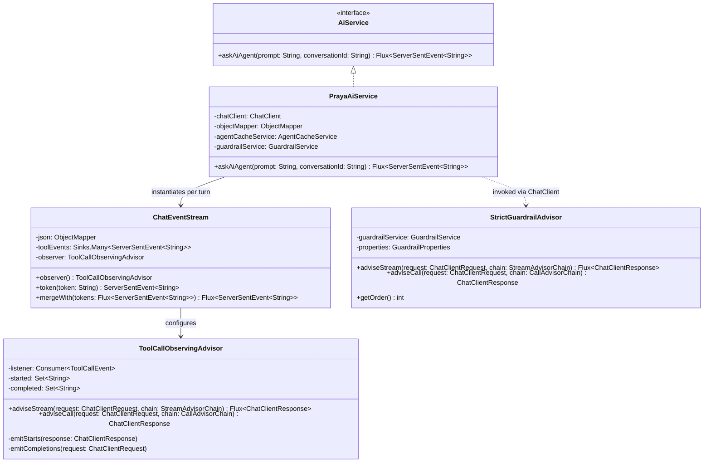
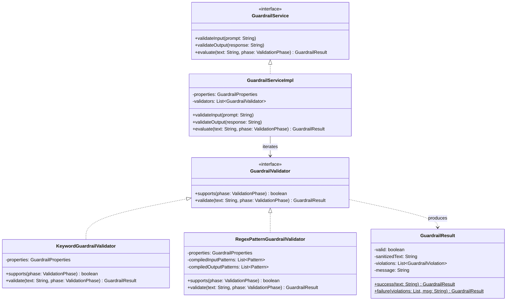
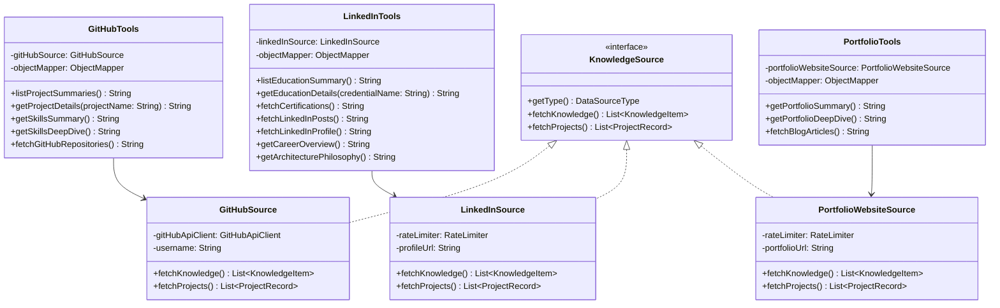
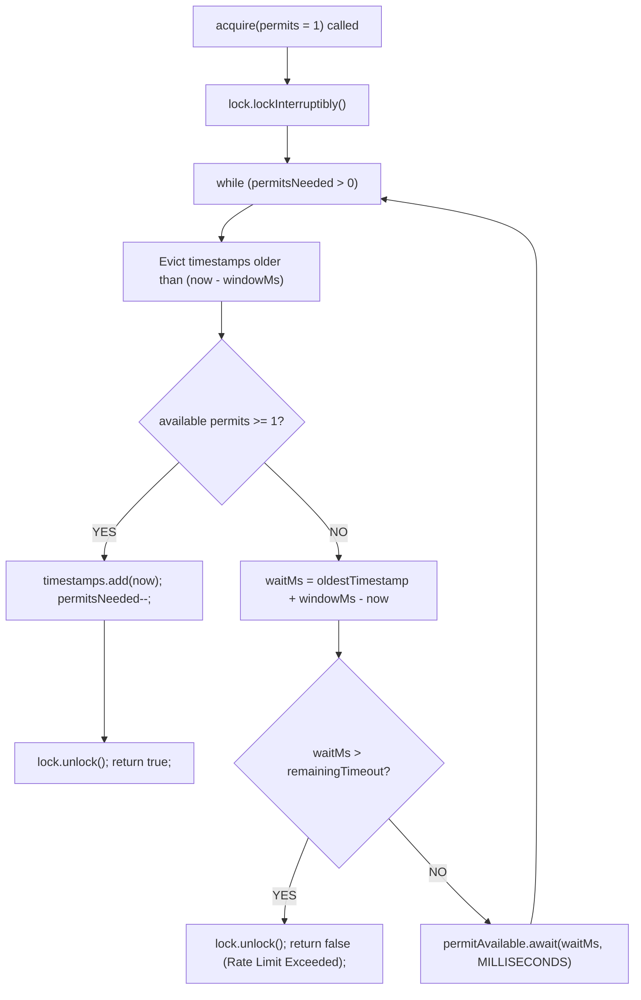

# Low-Level Design (LLD) — Praya AI Agent

---

## 1. Package Structure & Architectural Subsystems

The Praya AI backend is partitioned into domain-specific packages following Clean Architecture principles:

```
com.pranit.praya
├── Application.java                          # Spring Boot Entrypoint (DataSourceAutoConfiguration excluded)
├── cache
│   ├── config/CacheConfig.java               # Cache name constants (portfolio-projects, etc.)
│   ├── model
│   │   ├── CacheEntry.java                   # In-memory value wrapper with timestamp
│   │   ├── CacheSnapshot.java                # Immutable snapshot of cache metrics
│   │   └── QueryNormalizer.java              # Trimming, lowercasing, and whitespace collapse
│   ├── scheduler/CacheEvictionScheduler.java # Periodic cache TTL eviction daemon
│   ├── service
│   │   ├── AgentCacheService.java            # Spring @Cacheable / @CachePut service
│   │   ├── AtomicReferenceCache.java         # AtomicReference<ConcurrentHashMap> implementation
│   │   └── Cache.java                        # Cache SPI interface
│   └── spring
│       ├── AtomicReferenceCacheManager.java  # Custom Spring CacheManager implementation
│       └── AtomicReferenceSpringCache.java   # Custom Spring Cache implementation
├── chat
│   ├── AiService.java                        # High-level assistant contract
│   ├── ChatEventStream.java                  # Per-request SSE sinks and token formatter
│   ├── PrayaAiService.java                   # Core chat orchestrator
│   ├── ToolCallEvent.java                    # Tool lifecycle event (STARTED, COMPLETED)
│   └── ToolCallObservingAdvisor.java         # Advisor emitting tool lifecycle events
├── config
│   ├── AiConfig.java                         # ChatClient, ChatMemory, Advisor wiring
│   ├── CorsConfig.java                       # Reactive CORS configuration
│   └── JacksonConfig.java                    # Primary ObjectMapper bean with JavaTime module
├── constant
│   ├── AiConstants.java                      # System prompt, conversation ID, tool routing rules
│   ├── ApiConstants.java                     # HTTP header, user agent, timeout constants
│   ├── CorsConstants.java                    # Allowed origins, methods, headers
│   ├── ProfileConstants.java                 # Verified bio, URLs, core skills constants
│   ├── ProjectConstants.java                 # Baseline flagship software projects
│   └── StreamEventConstants.java             # SSE event types (token, tool, error, done)
├── controller
│   └── AgentController.java                  # Reactive REST endpoint for chat streaming
├── exception
│   └── GlobalExceptionHandler.java           # Global exception handler producing RFC 7807 ProblemDetails
├── github
│   ├── GitHubApiClient.java                  # RestClient wrapper for GitHub REST API
│   ├── GitHubSource.java                     # Live repository fetcher with curated fallback
│   └── GitHubTools.java                      # AI tools for projects, skills, and repositories
├── guardrail
│   ├── advisor/StrictGuardrailAdvisor.java   # Ordered.HIGHEST_PRECEDENCE input/output advisor
│   ├── exception/GuardrailViolationException.java
│   ├── model
│   │   ├── GuardrailResult.java              # Validation success/failure outcome
│   │   ├── GuardrailViolation.java           # Specific rule match descriptor
│   │   └── ValidationPhase.java              # INPUT vs OUTPUT enum
│   ├── properties/GuardrailProperties.java   # Configuration properties bean
│   ├── service
│   │   ├── GuardrailService.java             # Validation engine interface
│   │   └── GuardrailServiceImpl.java         # Validator strategy orchestrator
│   └── validator
│       ├── GuardrailValidator.java           # SPI interface for validators
│       ├── KeywordGuardrailValidator.java    # Substring / keyword scanner
│       └── RegexPatternGuardrailValidator.java # Pre-compiled regex scanner
├── linkedin
│   ├── LinkedInSource.java                   # Live profile JSoup scraper with AuthWall detection
│   └── LinkedInTools.java                    # AI tools for education, certs, posts, career
├── model
│   ├── BlogArticle.java                      # Immutable model for published blog articles
│   ├── CertificationRecord.java              # Immutable model for verified credentials
│   ├── ChatRequest.java                      # Client request payload (prompt, conversationId)
│   ├── DataSourceType.java                   # Enum: GITHUB, LINKEDIN, PORTFOLIO_WEBSITE
│   ├── EducationSummary.java                 # Lightweight credential summary
│   ├── GitHubRepoRecord.java                 # Public repository record
│   ├── KnowledgeItem.java                    # Scraped knowledge record with tags
│   ├── ProjectRecord.java                    # Full project architecture record
│   ├── ProjectSummary.java                   # Lightweight project overview
│   ├── SocialPostRecord.java                 # LinkedIn thought leadership post record
│   └── ToolResponse.java                     # Standardized envelope for tool outputs
├── portfolio
│   ├── PortfolioTools.java                   # AI tools for bio, deep narrative, blog articles
│   └── PortfolioWebsiteSource.java           # Live JSoup scraper for personal portfolio site
├── ratelimit
│   ├── annotation
│   │   ├── RateLimit.java                    # Declarative rate limit rule annotation
│   │   └── RateLimits.java                   # Container annotation for stacked rules
│   ├── aop/RateLimitAspect.java              # Spring AOP Around advice
│   ├── config/RateLimitConfig.java           # EnableAspectJAutoProxy configuration
│   ├── exception/RateLimitExceededException.java
│   ├── model
│   │   ├── RateLimitPolicy.java              # Parsed policy descriptor
│   │   └── RateLimitResult.java              # Decision result (allowed, remaining, retryAfterMs)
│   └── service
│       ├── ClientIdentity.java               # IP extraction and SHA-256 key hashing
│       ├── InMemorySlidingWindowBucket.java   # Fair lock sliding window bucket
│       ├── RateLimitMetrics.java             # Micrometer counters and timers
│       ├── RateLimiter.java                  # High-level limiter contract
│       └── RateLimitService.java             # Key-based bucket registry
├── repository
│   └── KnowledgeRepository.java              # Central in-memory collection store
└── source
    ├── KnowledgeAggregator.java              # Composite collector aggregating all sources
    └── KnowledgeSource.java                  # Strategy interface for data providers
```

---

## 2. Class Diagrams & Object Models

### 2.1 AI Orchestration & Streaming Pipeline



---

### 2.2 Guardrail Subsystem Architecture



---

### 2.3 Two-Tier Tool System & Data Sources



---

## 3. Concurrency & Algorithm Deep Dives

### 3.1 Fair Sliding-Window Rate Limiter Algorithm

Located in `SlidingWindowBucket.java`, this class protects against busy-waiting by utilizing a **fair
`ReentrantLock(true)`** and a **`Condition` variable**:



### 3.2 Real-Time Output Stream Guardrail Inspection

In `StrictGuardrailAdvisor.java`, streaming response chunks are checked dynamically without breaking SSE latency:

1. As each `ChatClientResponse` arrives from the reactive flux, its text content is extracted via
   `extractResponseText(chunk)`.
2. The chunk is appended to a thread-local `StringBuilder buffer`.
3. `guardrailService.evaluate(buffer.toString(), ValidationPhase.OUTPUT)` is invoked.
4. If output patterns match (e.g., system prompt phrase leak, secret keys, JWT patterns):
    - In **Strict Mode**, the stream is aborted immediately with `Flux.error(new GuardrailViolationException(...))`.
    - In **Non-Strict Mode**, the chunk is replaced with the configured safety fallback message.

### 3.3 Dynamic Tool Lifecycle Observation

In `ToolCallObservingAdvisor.java`:

- Extends both `CallAdvisor` and `StreamAdvisor`.
- `ORDER = ToolCallingAdvisor.DEFAULT_ORDER + 100`: Placed *inside* the Spring AI tool execution loop.
- Captures tool invocations before execution and records their completion when `ToolResponseMessage` is added to the
  instructions prompt list.
- Dispatches asynchronous events to the client's `Sinks.Many` for real-time UI status updates
  (`EVENT_TOOL: {"name":"listProjectSummaries","phase":"COMPLETED"}`).

---

## 4. API & Tool Specifications

### 4.1 REST API Endpoint Contract

#### Request: `POST /api/agent/chat`

- **Headers**:
    - `Content-Type: application/json`
    - `Accept: text/event-stream`
- **Request Body**:
  ```json
  {
    "prompt": "What projects has Pranit built?",
    "conversationId": "session-101"
  }
  ```

#### Response Stream: `text/event-stream`

```
event: tool
data: {"id":"listProjectSummaries","name":"listProjectSummaries","phase":"STARTED","timestamp":1700000000000}

event: tool
data: {"id":"listProjectSummaries","name":"listProjectSummaries","phase":"COMPLETED","responseData":"{...}","timestamp":1700000000050}

event: token
data: "Pranit"

event: token
data: " has"

event: token
data: " built"

event: token
data: " several"

event: done
data: ""
```

---

### 4.2 Comprehensive Tool Contracts

| Tool Method                           | Bean Class       |     Tier      | Multi-Line Description & Parameters                                                                                                                                     |
|:--------------------------------------|:-----------------|:-------------:|:------------------------------------------------------------------------------------------------------------------------------------------------------------------------|
| `listProjectSummaries()`              | `GitHubTools`    |  **Tier 1**   | Concise catalog of software projects. Returns lightweight `ProjectSummary` (id, name, summary, primaryTech).                                                            |
| `getProjectDetails(projectName)`      | `GitHubTools`    |  **Tier 2**   | Exhaustive architecture, tech stack, and highlights for target project. Accepts canonical aliases: `'open-connect'`, `'habit-tracker'`, `'todo-app'`, `'cleaning-bot'`. |
| `getSkillsSummary()`                  | `GitHubTools`    |  **Tier 1**   | High-level core languages (Java, Python, TypeScript) and primary frameworks.                                                                                            |
| `getSkillsDeepDive()`                 | `GitHubTools`    |  **Tier 2**   | Exhaustive breakdown across Languages, Backend, DBs, Cloud/DevOps, Architecture.                                                                                        |
| `fetchGitHubRepositories()`           | `GitHubTools`    | **Dedicated** | Returns public repositories with star counts, fork counts, primary language, and source links.                                                                          |
| `listEducationSummary()`              | `LinkedInTools`  |  **Tier 1**   | High-level academic credentials (PG-DAC CDAC, BE Electronics SPPU).                                                                                                     |
| `getEducationDetails(credentialName)` | `LinkedInTools`  |  **Tier 2**   | Comprehensive syllabus and coursework. Parameters: `'pg-dac'`, `'cdac'`, `'be'`, `'sppu'`.                                                                              |
| `fetchCertifications()`               | `LinkedInTools`  | **Dedicated** | Verified certifications, diplomas, and accreditation records.                                                                                                           |
| `fetchLinkedInPosts()`                | `LinkedInTools`  | **Dedicated** | Engineering posts, WebSocket resiliency write-ups, and clean architecture thought leadership.                                                                           |
| `fetchLinkedInProfile()`              | `LinkedInTools`  | **Dedicated** | Verified headline, connection URL, and professional identity.                                                                                                           |
| `getCareerOverview()`                 | `LinkedInTools`  |  **Tier 1**   | Systems engineer identity, role overview, and core backend competencies.                                                                                                |
| `getArchitecturePhilosophy()`         | `LinkedInTools`  |  **Tier 2**   | Clean Architecture, SOLID, TDD, and Reactive Streams engineering standards.                                                                                             |
| `getPortfolioSummary()`               | `PortfolioTools` |  **Tier 1**   | Bio tagline and verified official profile URLs.                                                                                                                         |
| `getPortfolioDeepDive()`              | `PortfolioTools` |  **Tier 2**   | Comprehensive about-me narrative journey and scraped portfolio text.                                                                                                    |
| `fetchBlogArticles()`                 | `PortfolioTools` | **Dedicated** | Technical blog articles, architectural deep dives, and estimated reading times.                                                                                         |

---

## 5. Global Exception & Error Handling

Centralized
under [GlobalExceptionHandler.java](file:///P:/praya-ai/praya-agent/src/main/java/com/pranit/praya/exception/GlobalExceptionHandler.java):

| Exception                         |          HTTP Status          | RFC 7807 Title                 | Behavior                                                                             |
|:----------------------------------|:-----------------------------:|:-------------------------------|:-------------------------------------------------------------------------------------|
| `GuardrailViolationException`     |      **400 Bad Request**      | `Security Guardrail Violation` | Rejects malicious prompt or suppresses leaked output with detailed violation reason. |
| `RateLimitExceededException`      |   **429 Too Many Requests**   | `Rate Limit Exceeded`          | Enforces client cooldown and populates `Retry-After` header.                         |
| `MethodArgumentNotValidException` |      **400 Bad Request**      | `Validation Failed`            | Identifies invalid input fields (e.g., blank prompt).                                |
| `ConstraintViolationException`    |      **400 Bad Request**      | `Constraint Violation`         | Reports parameter-level validation failures.                                         |
| `Throwable / Exception`           | **500 Internal Server Error** | `Internal Server Error`        | Logs full stack trace while withholding internal details from public clients.        |

---

## 6. Standardized Logging & Observability Standard

Praya AI enforces a structured, security-hardened logging pattern across all backend layers:

```
[<SUBSYSTEM>] [<ACTION>] key1: value1, key2: value2, durationMs: 123
```

### Security & Sanitization Rules

1. **Zero Sensitive Payload Logging**:
    - User prompts are never logged in full to protect against PII or prompt injection payload leakage; only
      `conversationId` and `promptLength` are recorded.
    - Secret keys, JWT tokens, passwords, and bearer authorization headers are never logged.
    - Guardrails log only the matched `ruleType` and standard violation message, never the captured sensitive text.
2. **Zero String Concatenation Overhead**:
    - All log invocations use SLF4J parameterized `{}` placeholders to eliminate runtime string allocation when log
      levels are disabled.
3. **Traceability & Timing**:
    - Schedulers record execution timestamps, item counts, and elapsed `durationMs`.
    - Data source scrapers log target endpoints, quantity of items/repositories retrieved, and fetch latencies.

### Standard Subsystem Catalog

| Subsystem Tag   | Action Tags                                                                                                                                                                                                                                                                                                                                 | Purpose & Metric Fields                                                                                                   |
|:----------------|:--------------------------------------------------------------------------------------------------------------------------------------------------------------------------------------------------------------------------------------------------------------------------------------------------------------------------------------------|:--------------------------------------------------------------------------------------------------------------------------|
| `[AI-AGENT]`    | `[INCOMING-REQUEST]`, `[INPUT-BLOCKED]`, `[CACHE-HIT]`, `[CACHE-MISS]`, `[TOOL-STARTED]`, `[TOOL-COMPLETED]`, `[RESPONSE-COMPLETE]`                                                                                                                                                                                                         | Tracks end-to-end chat turn lifecycle, cache efficiency, tool invocation events, generated character counts, and latency. |
| `[GUARDRAIL]`   | `[INPUT-BLOCKED]`, `[OUTPUT-BLOCKED]`, `[CHECK-FAILED]`, `[VIOLATION]`                                                                                                                                                                                                                                                                      | Records security validation failures with `phase`, `validator`, and `ruleType` without leaking matched content.           |
| `[RATE-LIMIT]`  | `[REJECTED]`, `[EXPRESSION-ERROR]`, `[ACQUIRE-ERROR]`, `[CHECK-ERROR]`, `[FAIL-OPEN]`, `[BUCKET-CLEANUP]`                                                                                                                                                                                                                                   | Monitors policy checks, client cooldowns, SpEL key resolution, and bucket eviction.                                       |
| `[DATA-SOURCE]` | `[GITHUB-FETCH-START]`, `[GITHUB-FETCH-SUCCESS]`, `[GITHUB-FETCH-FALLBACK]`, `[GITHUB-REPO-SKIP]`, `[LINKEDIN-FETCH-START]`, `[LINKEDIN-AUTHWALL]`, `[LINKEDIN-FETCH-SUCCESS]`, `[LINKEDIN-SCRAPE-GATED]`, `[PORTFOLIO-FETCH-START]`, `[PORTFOLIO-FETCH-SUCCESS]`, `[KNOWLEDGE-AGGREGATED]`, `[PROJECTS-AGGREGATED]`, `[REPOSITORY-LOADED]` | Records external fetch milestones, items scraped, API fallbacks, and aggregation timings.                                 |
| `[SCHEDULER]`   | `[CACHE-EVICT]`, `[DATA-REFRESH]`                                                                                                                                                                                                                                                                                                           | Logs periodic eviction of AI response cache and knowledge collection refresh timings.                                     |
| `[TOOL]`        | `[GITHUB-SERIALIZE-ERROR]`, `[LINKEDIN-SERIALIZE-ERROR]`, `[PORTFOLIO-SERIALIZE-ERROR]`                                                                                                                                                                                                                                                     | Captures JSON serialization errors within tool method boundaries.                                                         |
| `[SYSTEM]`      | `[UNHANDLED-EXCEPTION]`                                                                                                                                                                                                                                                                                                                     | Tracks unexpected runtime exceptions with sanitized request paths.                                                        |

